  

<h1 align="center">Opa! Eu me chamo Mateus!</h1>

  <i>Estudante de Ciência da Computação na UFCG · Campina Grande, Paraíba</i> 
  Olhe para cima: tudo o que eu construo vira uma estrela.

## Como ler este céu

- cada **repositório** é uma constelação
- cada **commit** torna-se uma estrela
- estrelas **recentes** brilham mais; as antigas vão ficando discretas

Se o céu está cheio, eu estive trabalhando. Se está escuro, é verdade também.

## Skills

### Linguagens de programação

  

### Ferramentas e tecnologias

  

## Novos ares

Estou aberto a oportunidades de estágio, desenvolvimento profissional, colaboração em projetos e novos desafios.

Se você chegou até aqui, talvez possamos construir algo interessante juntos.

  
  

  <i>"Great things are done by a series of small things brought together."</i>
   
  — Vincent van Gogh

